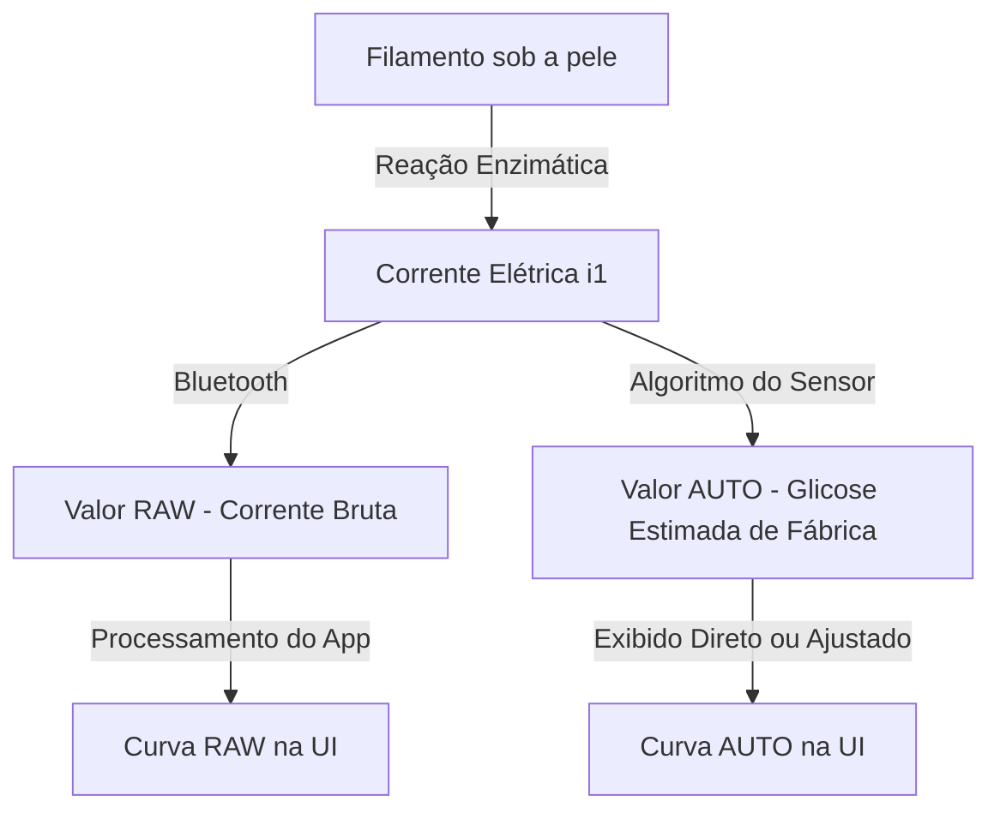

# Guia JugglucoNG Completo

Documento gerado a partir do codigo fonte do projeto JugglucoNG, com apresentação das principais funcionalidades do app.

Repositorio do projeto: 
[GitHub - ctqvva/JugglucoNG: JugglucoNG — Material 3 Expressive Compose UI fork of Juggluco · GitHub](https://github.com/ctqvva/JugglucoNG)
Download na seção release (ultima versão 1.0.3).

---

## Seção A: Fluxo de Dados e Exibição Visual (Raw vs. Auto)

Para entender os gráficos e as calibrações, é fundamental compreender a origem da informação. O sensor não "lê" a glicose diretamente; ele mede uma corrente elétrica.

### 1. Como o Sensor Lê a Glicose

Os dados são transmitidos pelo sensor via Bluetooth a cada 4 ou 5 minutos. O caminho dessa informação gera dois dados base que o aplicativo processa:

- **Curva RAW (Bruta)**
  
  - Representa o sinal elétrico puro (corrente `i1`).
  - Essa leitura não sabe o que é "mg/dL". O aplicativo multiplica esse valor elétrico por 10 (ou transforma matematicamente) para plotar a linha RAW na mesma escala visual da glicose.
  - **Objetivo:** Permitir que você veja o comportamento elétrico puro do sensor antes de qualquer filtro ou maquiagem matemática do algoritmo nativo.

- **Curva AUTO (Automática)**
  
  - É a glicose "derivada" pelo microchip do próprio sensor (*Factory Calibrated*) ou suavizada nativamente.
  - O fabricante (ou o algoritmo padrão) embutiu uma fórmula nele que tenta transformar a corrente elétrica em mg/dL.

> [!NOTE]
> **Por que isso importa?**
> Se a curva AUTO estiver errada (com falhas ou falsas quedas), mas a curva RAW estiver estável e limpa, significa que o problema não é o filamento na sua pele, e sim a fórmula matemática do chip que se perdeu. É aqui que entra a Calibração de Software (Seção B).

### 

---

## Seção B: Calibração (Ajuste de Dados)

Calibrar significa dizer ao sistema: "Você acha que minha glicose é X, mas a ponta de dedo diz que é Y. Ajuste-se". Existem duas formas de fazer isso, com impactos completamente diferentes.

### 1. Calibração de Hardware (Aba "Sensor")

- **Onde:** Botão "Calibrar" na aba **Sensor**.
- **O que faz:** Envia um comando Bluetooth diretamente para o chip do sensor no seu braço.
- **Impacto:** O sensor recalcula sua fórmula interna de fábrica e passa a enviar um valor **AUTO** corrigido. O aplicativo apenas obedece.
- **Atenção (Irreversível):** Não há como apagar a calibração de dentro do chip pelo app. Se você calibrar errado (ex: dedo sujo de açúcar), o chip enviará dados errados até que você o calibre novamente.

### 2. Calibração de Software (Aba "Definições")

- **Onde:** **Definições ➔ Calibração (Auto)**.
- **O que faz:** Salva a ponta de dedo apenas no banco de dados do seu celular. O sensor físico não fica sabendo.
- **Impacto:** O JugglucoNG intercepta o sinal Bluetooth (RAW ou AUTO) e aplica um filtro matemático por cima, redesenhando o gráfico na sua tela.
- **Atenção (100% Reversível):** Se a ponta de dedo estava errada, basta ir na lista do celular, apagar o ponto, e o gráfico volta ao normal imediatamente.

### 3. Algoritmos de Calibração (O Cérebro do App)

Quando a Calibração de Software está ativa, o aplicativo não faz apenas uma média simples. Ele usa algoritmos complexos:

- **Adaptive Ensemble (Recomendado)**
  - Mistura três modelos matemáticos simultaneamente.
  - É inteligente o suficiente para ignorar uma calibração que destoe muito do padrão, evitando que um erro estrague seu gráfico.
- **Outros Modelos** (como *Time-Weighted* e *xDrip Median Slope*)
  - Focam em dar mais peso para calibrações recentes.
  - São projetados para ignorar ruídos elétricos ou compensar o envelhecimento do sensor.

### 4. Boas Práticas: Como e Quando Calibrar

Para garantir que o algoritmo aprenda corretamente, siga estas regras:

- **Aguarde 24h:** O trauma da agulha na pele causa inflamação. Nos primeiros dias, o sinal elétrico é instável. Calibrar nesse período força o algoritmo a aprender com dados ruins.
- **Seta Horizontal ($\rightarrow$):** Nunca calibre com a glicose subindo ou descendo rápido (ex: logo após comer). Há um *"lag time"* (atraso de 10-15 min) entre o sangue capilar e o líquido intersticial que o sensor lê.
- **Menos é Mais:** Calibre no máximo 1 a 2 vezes ao dia (preferencialmente em jejum). Calibrar em excesso "confunde" a matemática do algoritmo adaptativo.

---

## Seção C: Reset do Sensor (Manipulação de Hardware)

Resetar o sensor serve para iniciar uma nova sessão ou corrigir falhas graves. O comando enviado e o efeito gerado variam de acordo com o hardware utilizado.

### 1. Sensores Sibionics

- **Hardware Reset (Mantendo Calibração):**
  - Envia o comando interno `Natives.setResetSibionics2`.
  - Apenas reinicia o estado de conexão do microchip e zera o timer interno para evitar bloqueios de tempo.
  - **Uso Ideal:** Preserva a inteligência e os históricos de calibração automática. Usado para resolver perdas de sinal ou travamentos leves.
- **Full Reset (Apagando Tudo):**
  - Executa o comando `Natives.siClearAll`.
  - Sofre amnésia total: apaga o banco de dados interno e as calibrações de hardware.
  - **Uso Ideal:** O sensor "acha" que acabou de ser fabricado. Ideal para falhas gravíssimas ou uso prolongado além do tempo recomendado.

### 2. Sensores AiDex

- **Extensão de Vida Útil:**
  - Executa o comando de hardware secreto `CLEAR_STORAGE` (`0xF3`).
  - Como o transmissor do AiDex é reutilizável, ele guarda a data de ativação do sensor e trava o uso após 14 dias.
  - O reset apaga essa data, "enganando" o transmissor para que ele inicie uma nova sessão de 14 dias no mesmo sensor físico.

> [!WARNING]
> **Aviso de Precisão:** Após os 14 dias originais, o filamento começa a degradar quimicamente. Ao estender o uso com o reset, a precisão pode cair, exigindo atenção extra (ponta de dedo).

### 3. Outros (Anytime, Dexcom)

- **Limpeza de Memória:**
  - Restabelecem a conexão Bluetooth ou limpam a memória do transmissor reutilizável.
  - Isso garante que ele aceite o pareamento de um novo sensor físico sem conflitos com o histórico anterior.

---

## Seção D: O Diário (Registros e Interface)

O Diário é onde tudo o que você registra interage dinamicamente com os algoritmos do aplicativo.

### 1. O que pode ser registrado?

- **Insulina:** Vinculada a um perfil de tempo de ação farmacológico.
- **Carboidratos:** Vinculados à velocidade de digestão e macronutrientes.
- **Ponta de Dedo:** Usada para controle ou para ativar a calibração de software.
- **Atividade Física:** Duração e Intensidade, que afetam diretamente a queima de glicose na simulação.

### 2. Biblioteca de Alimentos

Você não precisa calcular os macros toda vez que for comer.

- **Pratos Salvos:** Monte uma refeição (ex: "Café da Manhã Padrão") com a quantidade exata de carboidratos, proteínas, gorduras e tempo de digestão (rápida, mista, lenta). Salve-a na biblioteca do aplicativo.
- **Cor de Destaque (Accent Color):** Atribua cores específicas para bater o olho e identificar a entrada (ex: Azul para lanches, Vermelho para massas).
- **Seleção Rápida:** Ao registrar, basta tocar no prato salvo para preencher todas as métricas matemáticas instantaneamente.

### 3. Perfis de Insulina Personalizados (Presets)

O tempo de ação de uma insulina varia de organismo para organismo.

- **Perfis Embarcados:** O app vem equipado com dezenas de perfis farmacológicos precisos de fábrica (Fiasp, Lispro, Lantus, NPH, Afrezza, etc).
- **Criação Customizada:**
  - Se uma insulina age diferente em você, crie um **Perfil Customizado**.
  - Defina manualmente em quantos minutos ela começa a agir (*Onset*) e em quantos minutos ela para de fazer efeito (*Duration*). O algoritmo recriará a curva usando as suas âncoras de tempo exclusivas.

### 4. Marcadores Interativos no Gráfico

- **Selos (Badges) Coloridos:** Tudo o que você registra não fica escondido numa lista de texto. Os dados se transformam em "Selos" coloridos fixados no eixo do gráfico principal (acima ou abaixo das curvas).
- **Edição Expressa:** Errou a quantidade de insulina? Não navegue por dezenas de menus. Basta tocar no selo colorido no próprio gráfico para abrir a janela de edição imediatamente.

---

## Seção E: Calculadora de Dose

Ativada nas configurações do Diário, a Calculadora atua como um pâncreas virtual ajudando na matemática, seja para refeições ou correções.

### 1. Configurando o Perfil de Dose

Para que ela funcione, você precisa preencher 3 pilares:

- **Fator Carbo (Relação C/I):** Quantos gramas de carboidrato 1 unidade de insulina cobre (ex: 10g/U).
- **Fator de Correção (Sensibilidade):** Quantos mg/dL a glicose cai aplicando 1 unidade de insulina (ex: 50 mg/dL por U).
- **Alvo Superior:** A partir de que valor o app deve julgar que você está hiperglicêmico e sugerir uma dose de correção (ex: acima de 120 mg/dL).

### 2. O Passo a Passo do Algoritmo (Cenário Prático)

Imagine que você vai comer **50g de carboidratos**, mas sua glicose já está alta em **200 mg/dL**:

- **Passo 1 (Comida):** O sistema divide os 50g pelo seu Fator Carbo para achar a *Insulina de Base*.
- **Passo 2 (Correção Bruta):** O sistema subtrai o seu Alvo (120) do valor atual (200), restando 80 mg/dL a corrigir. Divide esse excesso pelo seu Fator de Correção para achar a *Insulina de Correção Bruta*.
- **Passo 3 (Proteção contra IOB - Dose Stacking):**
  - Se você aplicou insulina há 2 horas, o app usa as curvas de atividade (da Seção D.3) para calcular exatamente quanta insulina ainda está circulando no seu sangue.
  - Ele **abate essa insulina ativa da sua Correção Bruta** (mas nunca subtrai da insulina da comida).
  - *Vantagem:* Você corrige a alta sem o risco de acumular insulina perigosamente no corpo, prevenindo uma hipoglicemia surpresa horas depois.
- **Passo 4 (Dose Final):** O resultado final (Base + Correção ajustada) é consolidado, arredondado para a precisão da sua caneta (ex: 0,5U) e exibido na tela.

> [!TIP]
> **O processo reverso:** Ao registrar *apenas Insulina*, o app calcula a correção necessária para sua glicemia atual e traduz a insulina que sobrar, informando "Você pode comer X gramas de carboidratos com o resto dessa dose".

---

## Seção F: Absorção Alimentar e Simulação Preditiva

O JugglucoNG não apenas mostra o passado, ele gera uma **Sombra Preditiva** (Simulação) no gráfico, traçando o futuro da sua curva glicêmica nas próximas horas. 

### 1. Como a Linha Preditiva é Calculada

O algoritmo soma os efeitos independentes dos carboidratos ingeridos, da insulina ativa e da inércia de tendência:

* **O Impacto do Carboidrato:** O código divide os carboidratos informados pela sua Razão Carbo, e multiplica pela Sensibilidade. Ex: Para 65g, numa Razão de 20g/U e Sensibilidade 100, o app prevê uma elevação total de +325 mg/dL.
* **O Tempo de Absorção Base:** Esse impacto não ocorre todo de uma vez. O aplicativo divide a quantidade de carboidratos pela sua taxa global de absorção (ex: 35g/h), determinando em quanto tempo a glicose vai subir. Ex: 65g / 35g/h = 1h e 51 minutos.
* **O Impacto da Insulina:** Paralelamente, o sistema calcula a queda causada pela insulina (ex: 3U * Sensibilidade 100 = -300 mg/dL) subtraindo os valores de acordo com a curva de duração da insulina ativa (IOB).

### 2. Descompasso e Picos Acentuados na Curva

Muitas vezes o gráfico preditivo mostra picos bem severos durante as primeiras horas, e não uma curva atenuada. Isso ocorre devido a um **descompasso de velocidade** entre a digestão e a insulina.
A insulina rápida pode demorar de 4 a 6 horas para agir completamente. No entanto, os carboidratos (pelos cálculos padrões) entram muito rápido (em menos de 2 horas). Como o carbo ganha da insulina no início, a predição sobe muito, mas depois cai lentamente até a insulina terminar sua ação.

### 3. A Influência da Velocidade da Refeição (Achatando a Curva)

Para atenuar e "modelar" essa curva preditiva para refletir sua digestão real, o diário possui a opção de indicar a velocidade da refeição. Ao escolher um destes parâmetros, você **substitui** a matemática padrão (de 35g/h) por tempos fixos com uma curva sigmoidal (smoothstep):

- **Rápida:** Força toda a absorção a ocorrer em exatos **45 minutos** (ex: açúcar líquido, suco). A curva sobe como um foguete, de forma quase instantânea.
- **Mista:** Absorção em **90 minutos (1h 30m)** (ex: prato feito padrão).
- **Lenta:** Estica a absorção ao longo de **180 minutos (3 horas)** (ex: macarrão integral). A curva preditiva fica **muito mais atenuada e suave**, dando tempo para a insulina agir e evitando o pico alto na simulação gráfica.
- **Prolongada:** Distribui ao longo de **240 minutos (4 horas)** (ex: pizza, refeições densas).

### 4. O Efeito Cauda (Macros: Gorduras e Proteínas)

Se você habilitar os **Macros Alimentares**:

- O aplicativo converterá as proteínas e gorduras informadas na refeição em **FPU (Unidades de Gordura-Proteína)**.
- **O Impacto:** Uma pizza cheia de gordura e queijo não causa um pico imediato. As FPUs simulam um impacto glicêmico atrasado (podendo atingir um peso de até 80g de arrasto).
- Essa absorção só começará a entrar no sangue de 50 a 110 minutos após a ingestão, forçando a linha de predição do gráfico a ficar elevada por até 8 horas (480 minutos).

### 5. Atividade Física e Tendência

- **Exercício (Acelerador de Queima):** Exercícios intensos aumentam drasticamente a sensibilidade celular. Ao marcar uma Atividade Física, a linha de predição sofre uma **deflexão (queda) instantânea**, proporcional ao seu treino.
- **Inércia Atual:** O sistema avalia o "embalo" do seu corpo observando a angulação das últimas medições. Se a glicose já vinha caindo ladeira abaixo nos últimos 45 minutos, o modelo inclina a predição geral para respeitar essa inércia, evitando alarmes falsos.

---

## Seção G: Avançado – Suavização de Dados

A tela de suavização possui um **interruptor mestre** (liga/desliga) e, quando ligada, expõe quatro controles: o slider da janela e três chaves de escopo.

### 1. Interruptor Mestre (Ativar suavização)

Liga ou desliga toda a funcionalidade de suavização. Quando desligado, o código armazena internamente a última janela que você usou, para que ao reativar, o slider já volte na posição anterior em vez de resetar.

### 2. Janela de suavização (`smoothingMinutes`)

Um slider que permite escolher entre os valores fixos: **2, 3, 4, 5, 7, 10 ou 13 minutos**.
**O que o código faz:** A função calcula a metade da janela. Para cada ponto do gráfico, percorre os pontos vizinhos e calcula a **média aritmética simples** dentro dessa janela de tempo. O resultado substitui o valor original, eliminando ruídos e sobressaltos no gráfico. A suavização é aplicada independentemente às séries Auto **e** Raw em paralelo.

### 3. Suavizar só o gráfico (`graphOnly`)

* **Se ativada:** Apenas a linha visual do gráfico é suavizada. O valor numérico grande na tela principal, os widgets, os alertas e as saídas de API (xDrip, Nightscout) continuam recebendo o dado bruto original, sem filtro.
* **Se desativada:** A suavização afeta **tudo**: o gráfico, o valor principal exibido, widgets, alertas e saídas de troca.

### 4. Suavizar só saídas de troca (`exchangeOutputsOnly`)

* **Se ativada:** O gráfico, o valor numérico principal, widgets e alertas ficam **inalterados** (sem suavização nenhuma no lado visual). O filtro de média móvel é aplicado **exclusivamente** aos dados transmitidos pela API de saída. Útil quando você quer o gráfico fiel ao sensor, mas quer que o dado enviado para aplicativos externos seja mais estável.
* **Se desativada:** A suavização volta a seguir a regra geral.

> [!NOTE]
> As opções *graphOnly* e *exchangeOutputsOnly* são mutuamente exclusivas na lógica do código.

### 5. Agrupar em intervalos (`collapseChunks`)

* **Se ativada:** Após suavizar, o código executa uma segunda passagem dividindo toda a linha do tempo em "baldes" (buckets) de duração fixa (o menor valor entre a janela de suavização e 5 minutos). Dentro de cada balde, o código mantém apenas o **último ponto** e descarta os demais. O balde atual (aberto) nunca é descartado prematuramente.
  * *Exemplo prático:* Se configurou 10 minutos de suavização, o aplicativo agrupa os pontos a cada 5 minutos (teto máximo). Se configurou 3 minutos, agrupa a cada 3 min, gerando menos pontos visuais e economizando processamento.
* **Se desativada:** Todos os pontos suavizados são desenhados no gráfico normalmente.

---

## Seção H: Ecossistema e Integrações

O JugglucoNG funciona como uma central de interoperabilidade avançada, possuindo módulos autônomos para conversar com a nuvem e com sistemas médicos de loop-fechado (Pâncreas Artificial).

### 1. AndroidAPS (Pâncreas Artificial Autônomo)

O AndroidAPS (AAPS) é um aplicativo open-source poderoso que funciona como um pâncreas artificial gerindo uma bomba de insulina.

- **Comunicação Silenciosa:** O JugglucoNG captura silenciosamente os "broadcasts" (transmissões de rádio internas do celular) emitidos pelo AAPS em segundo plano.
- **Injeção de Dados:** Sempre que o AAPS envia uma microdose automática (microbolus) para sua bomba de insulina, o JugglucoNG lê esse pacote e insere a dose automaticamente no seu Diário local.
- **O Resultado:** Sua Simulação Preditiva e o cálculo de IOB ficam perfeitamente sincronizados com as ações robóticas do seu pâncreas artificial, sem que você precise digitar um único dado manualmente.
- *Ativação:* Acesse `Definições ➔ Diário ➔ Importar de AAPS`.

### 2. Sincronização em Nuvem (Nightscout)

O Nightscout é o sistema open-source de telemetria médica mais conceituado no mundo do diabetes.

- **Upload Imediato:** Tudo o que você digita ou integra no JugglucoNG sobe na mesma hora para o seu servidor web Nightscout. Ideal para manter seu médico e familiares atualizados em tempo real.
- **Download Remoto:** Se o seu médico ou cuidador anotar um recado, ou lançar um tratamento diretamente pela página web do Nightscout, o módulo `TreatmentTransfer` do JugglucoNG fará o download da informação e a fixará como um selo no seu gráfico local.

### 3. Captura Autônoma de Exercícios (Health Connect)

O seu esforço físico não precisa ser digitado à mão.

- **Google Health Connect:** Se você usa relógios esportivos (Garmin, Samsung Galaxy Watch) ou aplicativos como Strava e Google Fit, os dados de treinos vão para esse hub central do Android.
- **Integração:** Com a chave de importação ligada, o JugglucoNG interceptará os seus treinos (duração e intensidade exatas) assim que o relógio sincronizar com o celular.
- **O Resultado:** Esse esforço cardiovascular é injetado diretamente na sua Simulação Preditiva (Seção F) de forma 100% autônoma, fazendo a linha de tendência cair no gráfico automaticamente durante o exercício.

---

## Seção I: As Três Curvas na Interface e Modos de Exibição

Quando a Calibração de Software (ponta de dedo) é ativada, o JugglucoNG permite visualizar até 3 linhas diferentes no mesmo gráfico para que você acompanhe exatamente o que o algoritmo está fazendo.

Esses três valores são exibidos simultaneamente no pop-up (ex: `80 · 91 · 90`):

1. **Valor Calibrado (Principal):** A curva mais destacada (geralmente azul). É o valor final, ajustado pela sua calibração de ponta de dedo.
2. **Valor Auto (Secundário):** A curva intermediária (branca sólida). Mostra o que o app estaria calculando se não houvesse calibração manual.
3. **Valor Raw (Terciário):** A curva mais fina (cinza). A leitura pura do sensor.

**Modos de Exibição (Configurados nas opções do sensor)**O aplicativo agrupa esses dados dependendo do Modo (Display Mode) escolhido por você nas configurações:

* **Modo 2 (Auto+Raw):** Exibe as três curvas, priorizando o valor Auto logo após o Calibrado. O pop-up exibe o formato: *Calibrado · Auto · Raw*.
* **Modo 3 (Raw+Auto):** Inverte a ordem de prioridade visual. O pop-up exibe o formato: *Calibrado · Raw · Auto*.

**Limpeza Visual (Ocultar Valores Iniciais)**Para usuários que não desejam um gráfico poluído com três curvas, o aplicativo possui a opção em `Definições ➔ Calibração ➔ Ocultar`. Ao ativar esse recurso, o Juggluco **suprime o valor intermediário (Auto)** (no Modo 2) ou o Raw (no Modo 3). Dessa forma, a interface fica mais limpa, mantendo apenas o seu **Valor Calibrado** principal e uma das curvas base originais como referência.

### Opções da Aba "Ativar Calibração"

Além de ligar a calibração de software, há configurações finas para ditar como ela afeta seu histórico:

#### Ocultar valores iniciais (`hideInitialWhenCalibrated`)

Conforme explicado acima, suprime um dos dados intermediários (como o "Auto" no Modo 2) para limpar a interface, exibindo apenas o seu valor Calibrado e o valor base (Raw) no pop-up, evitando poluição visual.

#### Aplicar ao passado (`applyToPast`)

* **Se ativada:** O algoritmo aplica a inclinação e o desvio matemático da sua calibração mais recente retroativamente a **toda a linha do tempo** do seu gráfico. O histórico inteiro muda para se adequar à calibração atual.
* **Se desativada:** A calibração só passa a ter efeito total *do momento da inserção em diante*. Para evitar "degraus" (saltos abruptos) visuais no gráfico, o código cria uma pequena transição (*blend* proporcional) apenas nas leituras logo antes do seu registro de ponta de dedo, deixando o histórico antigo com os valores originais intactos.

#### Travar histórico passado (`lockPastHistory`)

* **Se ativada:** Para calcular o valor de um ponto no gráfico de ontem, o aplicativo usará **exclusivamente os pontos de calibração que estavam ativos naquele momento exato de ontem**. Uma calibração inserida hoje não afeta os cálculos do passado, "travando" o histórico.
* **Se desativada:** O aplicativo varre o banco de dados e recalcula o gráfico do primeiro ao último dia aplicando a sua lista de calibrações *atual*.

#### Manter histórico desativado (`keepDisabledHistory`)

*(Requer que a opção "Travar histórico passado" esteja ativada).*

* **Se ativada:** Se você excluir (desativar) um ponto de calibração antigo, o Juggluco não o apaga da memória matemática do passado. Ele continua aplicando a fórmula daquele ponto excluído **apenas para desenhar o trecho do gráfico passado em que ele era vigente**. Isso impede que fazer uma faxina nas calibrações estrague a visualização gráfica dos dias anteriores.
* **Se desativada:** Apagar uma calibração remove-a de qualquer cálculo histórico, forçando o pedaço do passado a se reajustar.

#### Modo visual (`visualContinuity`)

Atua apenas na interface da tela onde você digita a ponta de dedo:

* **Se ativada:** Ao abrir a janela para registrar a glicemia, o campo numérico virá pré-preenchido com o valor **já calibrado** atual (onde a curva principal azul está). Isso promove "continuidade visual", permitindo que você faça pequenos ajustes finos a partir de onde a sua linha já está.
* **Se desativada:** O aplicativo ignora a curva azul e pré-preenche o campo sempre com o valor base que o sensor está transmitindo (Auto ou Raw). 
